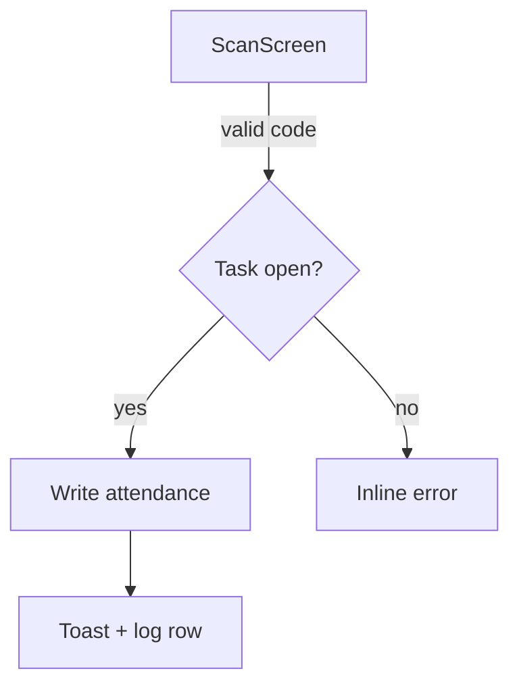

# UX Flow Designer — From Use Case to Handoff

> Method distilled from `ThomasPraun/ux-flow-designer`: keep use cases, Mermaid, and handoff; drop the HTML/Figma phase. Illustrate with ASCII, store the dossier in `docs/plans/`.

## 0. When to Use

- Adding a view or flow, changing navigation, specifying behavior by role (viewer < operator < manager < admin; a separate editor flag may unlock configuration).
- Not for restyling an existing view (→ `ui-redesign`) or responsive prevention (→ `responsive-craft`).

## 1. Adding a View Is a Six-Place Change

A new view is **not** just a new file. Find the project's equivalents and change all six together:

| Place | Change |
|---|---|
| View module | `views/view-<name>.js` (or equivalent) registered in the shared namespace |
| HTML shell | `<section id="view…">` in the app template |
| File manifest | add the entry, or the manifest test fails |
| Build order | add to the include order + view map; the allowlist is usually derived from the order |
| Page meta / nav | `PAGE_META` (or equivalent) — the source of view count and navigation |
| Docs | README view table, spec, architecture doc, progress log (append) |

Changing the view count changes a **documented number** → update docs in the same commit. Always write a plan and wait for approval (`docs/plans/`). Consider permissions: the client hides nav by role, but **the server gate is the final authority** — a hidden button is not a gate.

## 2. Phase 1 — Use Cases (present for approval before drawing)

| Field | Content |
|---|---|
| ID | `UC-001`, `UC-002`… |
| Name | Short imperative name |
| Actors | Role + system (kiosk/manager/admin) |
| Preconditions | Starting state, including the minimum role gate |
| Main flow | Numbered steps |
| Alternative flows | Error branches, edge cases (forbidden/out-of-station, task closed, offline) |
| Postconditions | Final state |

## 3. Phase 2 — Mermaid (after use cases are approved)

- **Screen map:** all views + global navigation.
- **Per use case, three diagrams:** `flow` (`graph TD`), `states` (`stateDiagram-v2`), `sequence` (`sequenceDiagram`).
- Constraints: ≤20 nodes per diagram (split into sub-flows beyond that); one `classDef` set (screen/decision/action/error); screens in PascalCase; actors named User/App/API/Auth/DB.



## 4. Phase 3 — Handoff

The flow dossier lives in `docs/plans/YYYY-MM-DD-<slug>.md` (plus a `-review.md` after verification). Do not create a new folder per flow.

Contents:

- Screen map.
- Table: Screen / Purpose / Wireframe / Use cases.
- Link to each use case's diagrams.
- Open questions for the visual phase (→ `ui-redesign`).

## 5. Illustration

ASCII is the default: box drawing `│─┌┐└┘▾▴` + labels/selectors taken **from the real code** (`#pageActions`, `#confirmDialog`, sidebar nav). Show **≥2 states** and a **mobile ≤700px** frame; write the interaction rules under the frame.

HTML prototypes only when the user asks → put them in a gitignored `tmp_` location, **never commit**.

```
┌─ Toolbar ────────────────────────────────┐
│ [Search…]            [Filter ▾] [New +]  │
├─ Table ──────────────────────────────────┤
│ Code    Name        Shift     Status     │
│ 001     A. Nguyen   Morning   Present    │
│ 002     B. Tran     Morning   —          │
└──────────────────────────────────────────┘
Mobile ≤700px: rows become cards; Filter moves into a sheet.
```

## 6. Verify

```bash
npm test          # build order, manifest, include allowlist, EOL/BOM
npm run build     # dist includes the new partial
npm run smoke     # boot + render + existing flows still pass
```

A new view must not break an old flow. If the repo has no persona/flow gate, say "manual per-role walkthrough" in the report instead of implying coverage.

## 7. Gate Honesty

Some repos have persona matrices (role × viewport, zero exceptions/empty/overflow) and flow gates (month navigation, import dialog, table→card). If yours does not, walk each role manually and record what you checked. Report with `audit-report-format`.

## Related Skills

- `../ui-redesign/SKILL.md` — visual phase after the flow is approved.
- `../responsive-craft/SKILL.md` — layout thresholds for the new view.
- `../writing-plans/SKILL.md` — the plan format this dossier extends.
